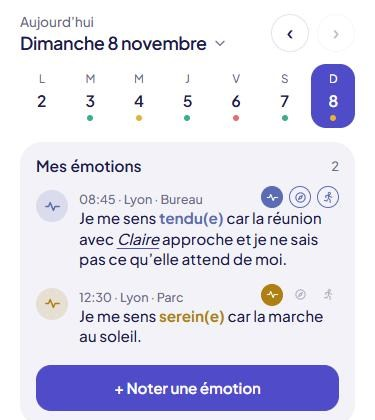
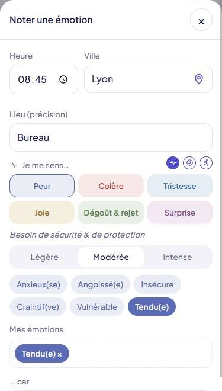
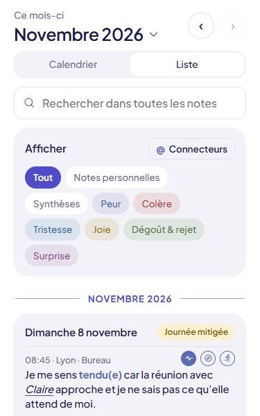
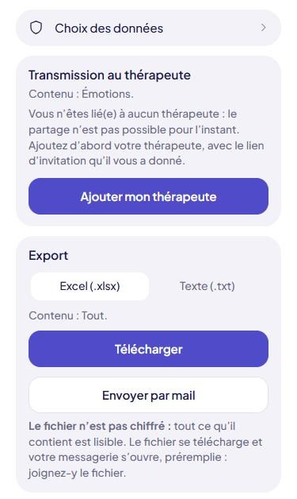

// ───────────────────────────────────────────────────────────────────────────────────────────────
// Guide d'utilisation de Motus, affiché dans Paramètres › Guide d'utilisation.
// Pour le modifier, il suffit d'éditer ce fichier texte : aucun code à toucher.
//
//   ## Titre                    une rubrique, qui s'ouvre d'un appui
//   ## Titre {utilisateur}      rubrique montrée seulement aux utilisateurs ({therapeute} : seulement aux thérapeutes)
//   ### Sous-titre              un intertitre dans une rubrique
//   - texte                     une ligne de liste à puces
//   1. texte                    une ligne de liste numérotée
//   > texte                     un encadré « astuce »
//   **texte**                   du texte en gras
//        une capture d'écran (.jpg ou .png), rangée dans ce même dossier guide/ (seule sur sa ligne)
//                               Captures : thème clair, largeur d'un téléphone, jamais la barre d'onglets du bas (l'onglet Admin n'y figure pas).
//
// Une ligne vide sépare deux paragraphes. Les lignes qui commencent par // ne s'affichent pas.
// Le texte placé avant la première rubrique s'affiche en tête de page.
// Une nouvelle capture est gardée hors connexion d'elle-même, dès qu'elle est citée ici.
// Pour que les téléphones reçoivent le guide modifié : augmenter APP_VERSION (js/constantes.js) et CACHE (sw.js).
// ───────────────────────────────────────────────────────────────────────────────────────────────

Motus vous aide à repérer ce que vous ressentez, ce dont vous avez besoin et ce que vous pourriez faire. Vos notes restent chiffrées sur votre téléphone : rien n'en sort sans une action de votre part.

## Quotidien : noter sa journée {utilisateur}

- **+ Noter une émotion** : où vous êtes, ce que vous ressentez et pourquoi.
- **+ Ajouter une note** : une pensée, un souvenir, quelque chose à ne pas oublier. Ces notes personnelles restent privées, sauf si vous choisissez de les transmettre ou de les exporter.
- **Synthèse de la journée** : le soir, une couleur (bonne, mitigée ou difficile) et quelques mots.

### Changer de jour

- Touchez un jour de la semaine, ou les flèches ‹ ›.
- Plus bas dans la page, remontez un peu : la semaine redescend sous la date, comme la barre Calendrier/Liste du Journal. Elle remonte quand vous redescendez.
- Touchez la date pour choisir un jour d'un autre mois ou d'une autre année.
- Glissez vers la gauche ou la droite sur la semaine : la semaine suivante ou précédente.

### Les cartes d'une émotion

Une émotion peut avoir trois cartes : l'émotion, le besoin et l'action. Les trois pastilles, à droite, montrent celles qui sont remplies.

- Glissez la carte vers la gauche ou la droite, ou touchez une pastille, pour passer de l'une à l'autre.
- Cochez une action dès qu'elle est faite, directement sur la carte ou dans la synthèse du jour.
- Appui long sur une carte ou une note : Modifier ou Supprimer.

## Noter une émotion {utilisateur}

1. En haut : l'heure, la ville (trouvée par le GPS si la localisation est activée) et le lieu.
2. **Je me sens…** : choisissez une famille, l'intensité, puis un ou plusieurs mots. Ajoutez la raison après « … car ».
3. **J'ai besoin de…** : glissez vers la gauche, ou touchez la 2e pastille. Choisissez vos besoins, puis dites-le avec vos mots.
4. **Je pourrais…** : une ou plusieurs actions concrètes, à cocher plus tard.

Seule l'émotion est obligatoire. Touchez **Enregistrer**.

> Le Répertoire (onglet du bas) présente toutes les émotions et tous les besoins, par famille, avec une recherche : utile pour trouver le mot juste.

## Les connecteurs @ {utilisateur}

Un connecteur relie des notes entre elles : une personne, un lieu, un sujet.

- Dans une émotion, une note ou une synthèse, tapez @ puis un mot : Motus propose ceux que vous avez déjà utilisés.
- Le tiret remplace l'espace : @un-ami s'affiche « un ami ». Les villes et les lieux saisis sont aussi des connecteurs.
- Touchez un connecteur dans une note pour voir toutes les notes qui le contiennent.
- Paramètres › Connecteurs : la liste complète, et le renommage dans toutes vos notes.

## Journal : relire et chercher {utilisateur}

- **Calendrier** : la couleur de chaque journée. Touchez un jour pour l'ouvrir.
- **Liste** : toutes vos notes, de la plus récente à la plus ancienne.
- Glissez vers la gauche ou la droite pour changer de mois ; touchez le nom du mois pour en choisir un autre.
- La loupe cherche un mot dans tout le journal. Les filtres et le bouton **@ Connecteurs** n'affichent que les notes voulues.
- Appui long sur une note : l'afficher dans Quotidien, ou la supprimer.
- Le bilan du mois montre les émotions et les besoins les plus fréquents.

## Partager avec son thérapeute et exporter {utilisateur}

- **Période** : la semaine, une autre période, ou tout le journal.
- **Choix des données** : ce que reçoit votre thérapeute, et ce que contiennent vos exports. Les besoins et les actions accompagnent leur émotion.
- **Transmission au thérapeute** : un fichier chiffré, que lui seul peut ouvrir. C'est votre messagerie qui fait l'envoi.
- **Export** : un fichier Excel ou texte (.txt), non chiffré, à garder ou à partager.
- **Rappel d'export** : une fois, chaque semaine, toutes les deux semaines ou chaque mois. Il s'affiche seulement dans l'app, en haut de Quotidien.
- **Mes semaines** : ce que vous avez déjà envoyé.

### Rejoindre son thérapeute

Paramètres › Mon thérapeute : collez le lien d'invitation qu'il vous a donné. Il doit accepter votre demande avant de pouvoir recevoir vos données.

## Garder ses notes en sécurité

- Vos notes sont chiffrées avec votre mot de passe, sur ce téléphone seulement.
- **Paramètres › Sauvegarde** : faites-en une régulièrement. Sans sauvegarde, un téléphone perdu ou changé emporte vos notes.
- **Mot de passe oublié** : un code est envoyé à votre mail de récupération.
- **Déconnexion automatique** : son délai se règle dans Paramètres › Mot de passe et verrouillage.
- Sur iPhone, ouvrez toujours Motus depuis son icône sur l'écran d'accueil : Safari et l'app installée ne partagent pas leurs notes.

## Pour les thérapeutes {therapeute}

- **Mon lien d'invitation** : à donner à vos clients, qui le collent dans leur app.
- **Clients** : acceptez les demandes en attente, puis importez les fichiers reçus ; chacun se range dans la fiche de son client.
- Dans une fiche : le calendrier et les journées en lecture seule, et l'export Excel.
- **Mon profil professionnel** : vos coordonnées, transmises à vos clients une fois leur demande acceptée.

## Une question, une idée ?

Paramètres › Nous contacter : le message part depuis votre messagerie.
